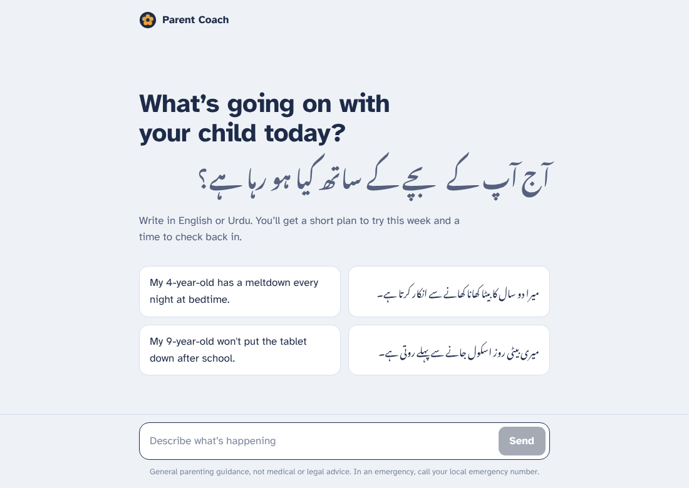
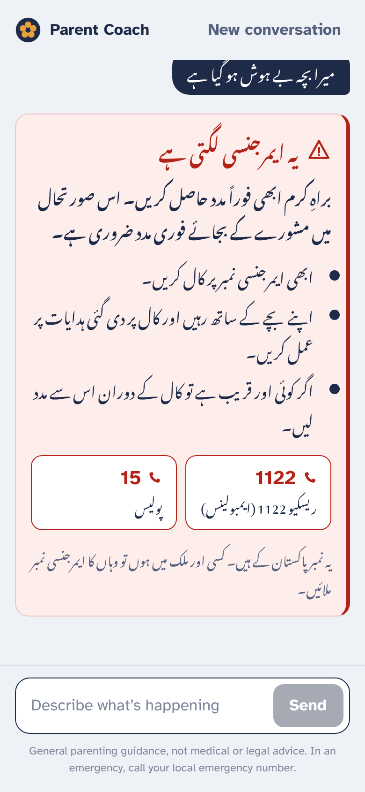

# Parent Coach

A small web app where a parent describes a concern in **English or Urdu** and an LLM coach replies with a short, structured plan and a follow-up check-in. Emergencies, abuse and self-harm are escalated with fixed, vetted safety messages and tap-to-call helplines instead of coaching.

**Stack:** Node.js + Express + TypeScript (API), React + Vite + TypeScript (UI), OpenAI or Anthropic (LLM), Vitest + Supertest (tests). No database, no login.

<p>
  
  
</p>

## Run it

Requires **Node.js 22.12+**.

```bash
npm install
cp server/.env.example server/.env   # add OPENAI_API_KEY or ANTHROPIC_API_KEY
npm run dev                          # UI on http://localhost:5173, API on :3001
```

Production build (the API serves the built UI on one port):

```bash
npm run build
npm start                            # http://localhost:3001
```

No API key? The app starts in **mock mode** with sample replies, so the UI and the crisis escalation can still be tried.

```bash
npm test          # 65 unit and API tests
npm run check     # typecheck + lint + tests (same as CI)
```

## How a message is handled

```
Parent message
   |
   v
[1] Crisis rules (English, Urdu script, Roman Urdu) ---- match ----> Vetted escalation + helplines
   | no match
   v
[2] LLM call: structured JSON (plan + risk label) ------ risk ------> Vetted escalation + helplines
   | risk = none
   v
[3] Output guard (doses, medicine names, diagnoses) --- blocked ---> Safe "see a professional" plan
   | ok
   v
Plan: acknowledgement, 2 to 4 steps, check-in (a question or a time to come back)
```

Key decisions:

- **Crisis wording never comes from the model.** The model only *classifies* risk. Once risk is detected, the server answers with fixed text in the parent's language (`server/src/safety/escalation.ts`), so the safety message is predictable and reviewable.
- **Two independent detectors.** Keyword rules are fast, deterministic and tuned for high-confidence phrases. The model catches nuance the rules can't ("my husband hits our son when he's angry") and is told to escalate when unsure.
- **Tuned for the audience.** Urdu text is normalised (Arabic vs Urdu letter variants, diacritics, zero-width joiners, Urdu digits). Everyday phrases are deliberately excluded, e.g. "abusing" alone (often means swearing in South Asian English), sibling hitting, "missing school", the Urdu idiom "زہر لگتا ہے".
- **Structured output, validated once.** Both providers use JSON Schema structured outputs. Every reply is validated with Zod (one retry on malformed output), and steps are capped at four.
- **Prompt injection.** The system prompt says the parent's text never changes the rules, and the server enforces the parts that matter (escalation, output guard) in code.
- **Privacy.** No database. History lives in the browser (`localStorage`) and is cleared with "New conversation". Server logs record which safety layer fired, never the message text.
- **Bilingual UI.** Replies and labels follow the parent's language, with right-to-left layout and the Nastaliq script Urdu readers expect. Fonts are self-hosted.

## API

`POST /api/coach`

```json
{ "messages": [{ "role": "user", "content": "My 4-year-old has a meltdown every night at bedtime" }] }
```

Response (plan):

```json
{
  "reply": {
    "kind": "plan",
    "language": "en",
    "acknowledgement": "Bedtime meltdowns are exhausting, especially at the end of a long day.",
    "steps": ["Start the same short routine at the same time each night.", "..."],
    "checkIn": { "type": "time", "text": "Come back in 3 days and tell me how bedtime went." }
  },
  "meta": { "source": "model" }
}
```

Crisis replies have `"kind": "escalation"` with `category`, `title`, `message`, `actions`, `helplines` and `regionNote`. `meta.source` shows which layer answered: `model`, `safety_rules`, `model_risk`, `output_guard` or `model_refusal`.

Validation errors return `400`, rate limiting (20 requests/minute per IP) returns `429`, provider failures return `502`, always as `{ "error": { "code", "message" } }`.

## Configuration (`server/.env`)

| Variable | Default | Notes |
| --- | --- | --- |
| `OPENAI_API_KEY` / `ANTHROPIC_API_KEY` | | Set one. With neither, mock mode. |
| `LLM_PROVIDER` | auto | `openai`, `anthropic` or `mock`. |
| `OPENAI_MODEL` | `gpt-5.4-mini` | |
| `OPENAI_REASONING_EFFORT` | unset | `low` keeps replies fast on reasoning models. Leave empty for non-reasoning models. |
| `ANTHROPIC_MODEL` | `claude-haiku-5-5` | e.g. `claude-opus-5-5` for higher quality. |
| `ANTHROPIC_EFFORT` | unset | `low` to `max`, on models that support effort. |
| `HELPLINE_REGION` | `PK` | `PK` (Pakistan), `AE` (UAE) or `INTL` (generic advice only). |
| `PORT` | `3001` | |
| `LLM_TIMEOUT_MS` | `45000` | |

## Project structure

```
server/src
  app.ts                  Express app factory (helmet, rate limit, static UI)
  config.ts               Env parsing and validation (Zod)
  coach/
    coachService.ts       Orchestrates the three safety layers
    prompt.ts             Versioned system prompt
    types.ts              API contract, model output schema
  safety/
    crisisRules.ts        Keyword rules (EN / UR / Roman Urdu)
    escalation.ts         Vetted crisis messages (EN / UR)
    helplines.ts          Region helpline directory
    outputGuard.ts        Blocks doses, medicines, diagnoses
  llm/                    OpenAI, Anthropic and mock providers behind one interface
server/test               Rules, guard, service and HTTP tests
client/src
  hooks/useCoachChat.ts   Chat state, request lifecycle, persistence
  components/             Welcome, PlanCard, EscalationCard, Composer, ...
```

## Limitations and next steps

- Keyword rules don't understand negation ("he is *not* suicidal" still escalates). That trade-off is deliberate: a false alarm is safer than a missed crisis.
- Roman Urdu crises get the English template; a Roman Urdu version is a small addition.
- Helpline numbers were checked in Nov 2026 but should be re-verified, and expanded per market, before launch.
- Next: a labelled evaluation set (everyday, borderline and crisis messages in all three scripts) run in CI against the real model, streaming replies, and review of escalation rates.
